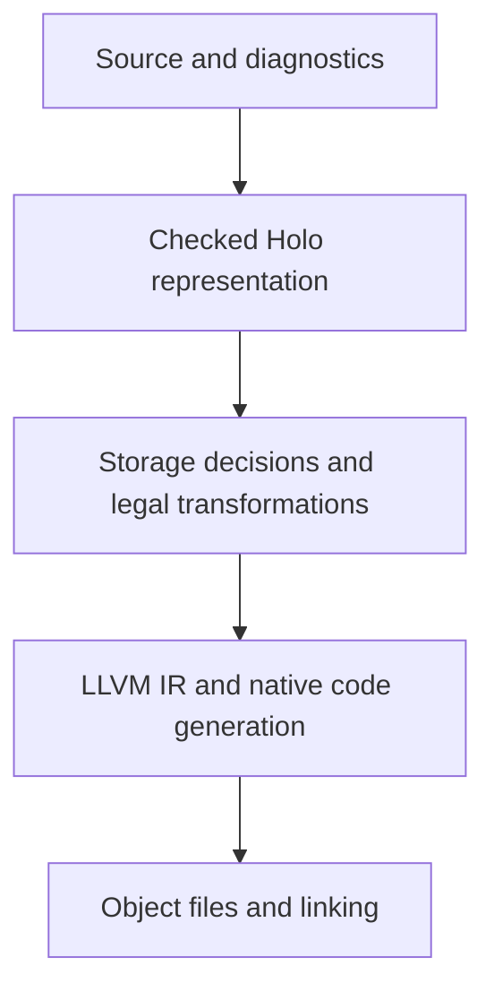

# Compiler architecture

**November 10, 2026 — finite M1 checked core accepted under its reviewed native profile.**

This document connects the [language specification](spec.md) to the
[implementation plan](implementation-plan.md). The [research map](research.md)
records the broader evidence. Historical comparisons use **Holo-current** for
the retired prototype and **Holo-new** for the checked-region compiler.

The first increment now implements the [structured construction IR](../compiler/src/ir.rs),
[checker](../compiler/src/check.rs), [LLVM backend](../compiler/src/backend/llvm/README.md), and native driver.
It executes real generated programs and has an independent model/native harness.
The [experimental frontend](../compiler/src/frontend/README.md) now parses preferred source
headers and lowers a deliberately restricted subset to this same representation.
Automatic source-to-data-stack assignment remains pending. Checked schema layout
planning now supports explicit wide, header-derived u64, and compact u32 experiments.
See [the source guide](../compiler/src/README.md) for exact boundaries and packed
representations. Source and IR tests are labeled separately.

The [generated cleanup audit](implementation-plan.md#generated-cleanup-path-acceptance--november-9)
now preserves original/optimized/native reset, rollback and multi-owner/early-exit
paths. Its 252 native executions and 45 independent model outcomes pass; source
typed-origin and actual instruction evidence have separate roles. Optimized
private marker stores can disappear, while allocator frees remain distinct.
The historical [M1 acceptance review](implementation-plan.md#m1-acceptance-review--november-9)
identified the native contract gap. The [November 10 helper audit](implementation-plan.md#generated-helper-contract-audit--november-10)
now records introduced memcpy/memset and the producer assertion-to-abort boundary,
including installed abort cleanup/sleep callsites. Those are potential paths, not
an observed sleep on a normal crash. The user subsequently approved the
[strict trap/runtime-profile boundary](implementation-plan.md#concrete-decision-package-for-m1)
for M1. Generated assertions use the target trap without Holo logging/cleanup
before host transfer. Its [completed acceptance](implementation-plan.md#m1-acceptance-decision--november-10)
now includes eager Darwin arm64 binding and a pinned runtime-helper profile.
This profile is host acceptance orchestration with explicit trusted assumptions,
not an always-on universal CLI effect verifier. Physical reset latency remains
unresolved, generic commitment unavailable, and other profiles unestablished.

The [approved inference policy](spec.md#inference-and-explicit-promises) keeps
ordinary helper annotations optional and explicit contracts as checked requirements.
The current restricted source graph already accepts an annotated caller using an
unannotated pure helper. General inferred summaries, callable-interface metadata
and backend/runtime effect verification remain unfinished. Establish those effects
before treating an inferred or written contract as a complete native guarantee;
the policy does not require a new compiler path or change storage semantics.

## Repository ownership

The root Cargo workspace contains the [compiler](../compiler/README.md) and
[CLI](../cli/README.md). `holo-compiler` exports the experimental Rust library
`holo`; the `holo` executable package depends on that one implementation. The
public `holo::llvm` path remains stable while its Rust source is visibly located
in `compiler/src/backend/llvm/`.

| Home | Responsibility |
|---|---|
| `compiler/src/` | Parsing, checked IR, lifetime/effect validation, layout planning, LLVM emission and native driver. |
| `cli/src/` | Command-line argument handling, diagnostics presentation, output protection and process status. |
| `runtime/` | Embedded LLVM prelude and conditionally compiled C measurement plumbing consumed by the compiler/driver. |
| `lib/` | Future Holo-written libraries; current `core.*` operations are compiler-recognized experimental APIs, not Holo source modules. |
| `examples/` | Runnable Holo programs. Rust API demonstrations live in `compiler/examples/`. |
| `tests/` | Integration suites organized by compiler, runtime, CLI and reference semantics. The CLI package registers each Cargo target. |
| `build/` | Disposable Cargo cache, example outputs, benchmark work and failure replay inputs, separated by purpose. |

Cargo's repository configuration selects `build/cargo/`. Compiler provenance
retains that configuration alongside manifests and source. The
[implementation plan](implementation-plan.md) summarizes historical experiments,
and the [test guide](../tests/README.md) describes maintained validation.

## 1. Priorities and backend direction

Build a small, explicit checked representation of Holo programs, then lower it to
LLVM for optimized native compilation. Keep the compiler implementation in Rust
initially and reuse suitable infrastructure without inheriting the old prototype's
heap, aggregate-return, or exclusive-borrow restrictions.

Correctness and soundness are acceptance gates. Pursue native execution speed,
memory efficiency, compiler responsiveness, and clear diagnostics together.
Review a tradeoff that weakens an accepted guarantee as a design decision.

Two kinds of performance need separate evidence:

- **Program performance:** throughput, latency, bytes moved, allocations, copies,
  working-set size, and reclamation work in the generated executable.
- **Compiler performance:** checking latency, clean and incremental builds,
  optimization/code-generation time, linking, and compiler memory use.

A faster backend does not automatically produce faster executables. LLVM already
performs instruction selection, register allocation, scheduling, and native code
emission. A custom emitter would take responsibility for these mechanisms rather
than inherently improve them. [LLVM code generator](https://llvm.org/docs/CodeGenerator.html)

## 2. Preserve meaning before lowering

The pipeline below names responsibilities, not a requirement for five separate
IR frameworks or an immediate MLIR dependency:

An intermediate representation, or IR, is the compiler's working description of
a program. Holo needs one that retains language facts until their obligations
have been checked and their useful transformations performed.

| Component | Responsibility | Important boundary |
|---|---|---|
| Frontend | Parse the preferred source form and preserve source locations. | Parsing does not establish memory safety. |
| Checked representation | Resolve types, references, roots, effects, initialization, destinations, and control flow. | Unresolved rules must remain visible; unknown facts are not optimizer promises. |
| Storage planning | Select eligible inline layouts, data-stack assignments, marker lifetimes, metadata, and construction locations. | Specify growth, exhaustion, failure, and reset behavior before lowering it. |
| Transformations | Specialize or transform operations using established legality conditions. | Preserve observable behavior, error order, numeric rules, and lifetimes. |
| LLVM lowering | Express established storage operations and verified semantic facts as LLVM IR. | The LLVM verifier checks IR validity, not Holo's source-level memory safety. |
| Driver | Select target/toolchain, verify, optimize, generate objects, and link. | Record actual CPU features, versions, options, and phase timings. |

The implemented source path separates byte-span diagnostics/lexing, spanned AST
parsing, pure definition lowering, and entry lowering. `SourceProgram` owns lowered
IR and a preorder operation-span map; its immutable input keeps checker positions
stable. `SourceProgram::check` returns the existing private checked-program token.
Definition validation supplies declaration diagnostics; entry checker errors map
to their innermost source operation. There is one checking/backend path.

The `parse_experimental` API and the CLI support temporary `core.*` operations
and limited function forms. Scalar templates inline only
after entry arguments are captured once left to right. Region/batch declarations
wrap their remaining lexical block. Cleanup-aware entry completion emits reverse
marker/backing cleanup without per-record work. General calls, effects, transfer,
additional numeric types, and collection APIs remain open where stated
in the [source boundary](spec.md#experimental-source-subset). Compiler trees use
host allocations; bounded expansion does not promise fast/incremental checking.

The first representation should be compact and inspectable. Prefer indexed stores,
interned identities, and clear ownership over allocation-heavy pointer graphs
when they serve the implementation. Measure compiler costs rather than assuming
that a particular representation is faster.

Carbon is useful prior art: its pipeline includes a checked semantic IR before
LLVM, with contiguous storage and small handles. Its checking design attempts to
complete much semantic work in a single ordered traversal where its rules permit.
These are frontend techniques, not evidence of faster Holo executables.
[Carbon architecture](https://docs.carbon-lang.dev/toolchain/docs/),
[Carbon checking](https://docs.carbon-lang.dev/toolchain/docs/check/)

### Host source tools

The source tools keep shared Rust logic in `compiler/src/` and command
presentation in `cli/src/`. The lossless `lex::scan` iterator borrows UTF-8
byte extents and preserves trivia;
strict parser tokenization adapts that same mechanism, validates numeric values,
and retains its existing diagnostics. `highlight::highlight` adds fixed-context
lexical category hints without source-sized collections or name copies. These
categories are neither semantic resolution nor evidence that an effect is proved.

Terminal styles are finite CSS-like data in `cli/styles/aurora.hss`, compiled once
into category/chrome ANSI prefixes. The buffered renderer owns colour policy,
optional headers/numbers/frame and control-character display. Ordinary plain pipe
output takes a direct byte-preserving path.

`format::format` parses syntax, emits conservative layout, then reparses and
compares syntax structure plus exact non-whitespace token/comment spelling.
It preserves identifiers, grouping, declaration order and grammatical newline
meaning. It allocates parser trees, tokens and output, and sorts selected
boundaries; it has no allocation-free/strict-linear claim. It is restricted to
experimental grammar, performs no width reflow, and does not run lifetime/effect
checking. CLI stdout/check and explicit file replacement share this one engine.
[CLI source tools](../cli/README.md#highlight-and-format-source)

Compilation collects [naming advisories](spec.md#naming-diagnostics-and-renaming-tools)
at declaration tokens before resolving package identities. The frontend stores
these diagnostics beside the original span map. The CLI renders them only after
source checking and enforces `--strict-names` before tool discovery. Collection
is disabled for dependencies and formatting. The checker, storage plan, and
LLVM IR carry no naming-policy state.

## 3. Memory facts the compiler must retain

A scoped construction records one tail claim while checking its success block.
The final address passed to the producer becomes the readonly success reference.
The native cleanup stack carries a marker restore through early completion.
Marked producers restore on a failed arm before user code. Cursor producers
already leave the marker unchanged on failure. This uses the same checked
producer and layout machinery as batch publication and skips batch metadata
and indexed lookup.
[Scoped construction and rollback](implementation-plan.md#fresh-aggregate-locals)

### Placing one scoped aggregate

The [one-site proposal](spec.md#compiler-selected-backing-for-one-scoped-aggregate)
puts the placement choice before checked IR verification.
`placement::place_scoped_aggregate` wraps the entry suffix selected by
`ScopedPlacement::acquire_at` in an ordinary `Op::Region`. A request supplies
capacity, acquisition recovery, and the insertion path for one typed constructor.
The path descends through scopes, counted iteration, batches, explicit region
success bodies, or refill data bodies. The last index selects a position
among existing operations in that body. For example, `[0, 1]` enters the
first operation's body and inserts at index one. Recovery and conditional
branch selection are outside this prototype.

Placement reserves a compiler-only binding for the generated owner and
the region operand in the generated `Op::ConstructHandled`. The verifier
recognizes those two operations by identity during admission and rejects
ordinary entry lookups and declarations of that binding. The same schema,
producer, actuals, and handler bodies still enter the shared checker. The
ordinary IR returned by placement requires a fresh `check::check` to obtain
backend authorization. Any future source adapter must preserve constructor
and handler spans through elaboration.

The checker already grants a tail by region root and grants the success
reference a distinct lexical root. It verifies permissions, competing owners,
and aliases. The placement step establishes which region is selected. The
checker still verifies whether the selected construction is legal. Reuse
region setup, cleanup, and destination emission. Preserve the fixed, deferred,
and marker-based producer conventions and the layout planner's size and
capacity checks. A marker restore is an abstract state transition. An already
unchanged cursor or a store proved dead by LLVM can leave less native work.
Keep source-visible behavior and generated instructions separate in the
acceptance record.

Byte-identical LLVM against an explicitly selected region with matched
ownership, layout, and behavior is the admission criterion for native code
parity. Placement adds compiler-side validation. Setup allocation and
checked reservations retain their existing costs. Runtime stack budgeting,
cross-function placement, backing policy changes, and capacity-check
elimination require separate evidence and decisions.
[Acceptance cases](implementation-plan.md#automatic-placement-experiment)

### Lowering the source budget

The [experimental source form](spec.md#supplying-a-stack-budget-in-source) gives the
owner an explicit brace-delimited lifetime with
`with core.region(capacity) { … } else { … }`. The parser recognizes this
token prefix in statement position. The binder resolves the one-operand
`core.construct` subject through the existing constructor and package rules.
The frontend diagnoses a missing recovery or site at the owner and an extra
or misplaced site at the construction statement.

The frontend selects the site in the source tree before explicit region
declarations wrap their lexical tails. It lowers the capacity expression
in the surrounding environment. The two brace blocks become one
`Op::Region`, followed by the ordinary continuation. The selected
`Op::ConstructHandled` uses its private region operand. Source verification
uses the two operations' preorder identities in the shared placement check.
The ordinary layout planner and emitter receive the existing IR. The budget,
constructor, and handler spans remain in the frontend's source map.

Entry termination analysis considers both acquisition outcomes. If
either can fall through, the following statements still determine whether
entry terminates. Capacity expressions and constructor actuals keep their
existing evaluation order. Formatting preserves the owner, recovery, and
constructor arms.
[Source acceptance cases](implementation-plan.md#source-budget-and-acquisition-recovery)

### Checked memory facts

For the checked region subset, represent enough information to establish:

- Which storage/root bounds each reference and whether it may escape.
- Which construction destination receives a result through nested calls.
- Which value may extend at a data-stack top and what may coexist with it.
- Why a permitted extension preserves existing references and their access rights.
- Which values have been initialized when an operation fails or exits early.
- Which marker resets are permitted on every control-flow exit.
- Which instructions and callees allocate or synchronously block.
- The size, alignment, offsets, metadata, and access method of each selected layout.

These are required modeling responsibilities; their full source-language rules
remain subject to the specification's statuses and open decisions. M1-R1 now
selects alias-permitting access for the initial slice; broader references and
sharing remain open. Internal IR operations do not finalize source collection APIs.

The plain scoped-data release path must reset a fixed set of markers without an
object walk, individual frees, reference-count updates, or hidden relocation.
Supported growth must be both stable and cheap: inspect capacity-management work,
copies, metadata, and slack rather than checking addresses alone. Account for the
full [Goose compatibility checklist](spec.md#goose-performance-compatibility-checklist).

Keep logical reset separate from backing-memory release and external-resource
cleanup. Virtual reservations are finite; page commitment, page faults, resident
memory, and exhaustion need explicit policies and measurements. A fresh bump
allocation is still allocation under the intended strict `noalloc` contract.

LLVM can optimize a sound lowering. It cannot invent Holo's lifetime guarantees
or recover a destination-construction obligation discarded earlier. Good input IR
and accurately conveyed facts matter to generated-code quality.
[LLVM frontend guidance](https://llvm.org/docs/Frontend/PerformanceTips.html)

The historical bounded-backing acceptance suite tested M1-R3 through parsed
source. It kept the original checked LLVM and a diagnostic module that
renamed only direct malloc and free call targets. Fixed owner metadata observed
real calls and injected NULL at a selected acquisition. Record construction,
scans, and marker resets remained compiler-generated. O0/O3/ASan controls
validated long refill sequences, finite exhaustion, retained prefixes, and
cleanup after failed acquisition.
Darwin live-range mapping/page queries and task totals are separate observations,
with bounded C-owned competing storage kept outside Holo allocation counters.
The suite left the production runtime and backing policy intact. Reset latency,
generic commitment, genuine OS pressure, and Holo trim and recommit remained
outside the results. The selected programs terminated after failed acquisition.
[Backing acceptance results](implementation-plan.md#bounded-backing-acceptance--november-9) ·
[Maintained owner lifecycle tests](../tests/runtime/owner_lifecycle.rs)

The source adapter now separately supports handlers that finish the owner's
block and resume outside it, preserving the existing Region success/failure
operation and lexical cleanup. Handler lowering precedes owner binding; main's
reverse termination fold checks both the success tail and recovery, so a return
that only exists in the success tail cannot hide failure-path fallthrough.

The implemented [layout planner](../compiler/src/layout.rs) operates on the checked schema
graph using an iterative dependency walk and checked static extent arithmetic.
It elides fixed/sole-variable-tail size headers conservatively and retains headers
for more complex shapes. An initialized one-byte empty-record representation
preserves positive iteration. Full-width and narrow-byte-length modes share
one LLVM path for construction, projection, indexing, cursor traversal, and
rollback. Per-schema typed step helpers load stored sizes or derive the extent
from frozen metadata; no runtime function-value dispatch or payload scan is added.
Explicit compact lengths are range-checked at their original field evaluation
point before narrowing. `inspect-layout` exposes widths, symbolic offsets, and
decisions without requiring LLVM. Physical-mode changes can change capacity
outcomes; they never establish uniqueness or remove safety guards by spelling.

### Typed byte-input path

**Implemented experimental path, November 9.** The [readonly byte-input design](spec.md#readonly-byte-input-construction-proposal)
extends approved initialized-input construction without a general slice runtime.
It uses one typed checked representation and the existing layout/LLVM path.

| Component | Implemented responsibility |
|---|---|
| `ir.rs` | Replace scalar-count-only producer signatures/call arguments with typed scalar and borrowed-byte forms. Keep byte input length/read distinct from numeric scalar parameters. |
| Frontend functions | Admit `Bytes as readonly reference` only on record producers. Type-check input observations; forward typed parameters through named calls and synthetic nested literals. Preserve expansion/substitution depth and node budgets for new expression children. |
| Frontend entry lowering | Resolve complete byte-field projections through existing live record references. Capture typed arguments once in source order, preserving diagnostic spans and readonly downgrade. |
| Definition and scope checkers | Validate formal/actual types and transitive destination-only effects; retain originating roots/projections at call sites. Prove initialized source extent and reject escapes/unfinished-output access independently of the frontend. |
| LLVM lowering | Pass borrowed location/length as ordinary call operands alongside the hidden final destination; implement checked input reads. Preserve existing header/field reservation and failure order. No mandatory payload temporary, allocator, lock, or reference count is introduced by the descriptor. |
| Independent model | Represent source identity, projection, and captured extent with safe semantic values, not native pointers or compiler layout helpers. Model copy costs are not evidence of native copies. |
| Tests and examples | Migrate programmatic callers to typed signatures. Add positive/negative IR and parsed-source cases, then native O0/O3/ASan under Wide/Derived64/Compact32. |

A pointer plus u64 length is the current internal lowering. It is not
a frozen ABI, a user-accessible pointer, or a reason to erase checked root identity
before validation. Retain scalar-only calls without dummy byte arguments or runtime
dispatch. Do not add an alternate unchecked backend or a host-language copy kernel.

The [synchronous borrowed-buffer subset](spec.md#synchronous-borrowed-buffer-functions)
adds ordinary mutable calls beside this construction path. Top-level IR function
declarations form a separate acyclic call graph. The verifier checks typed live
roots and access at each call, then checks each definition in a parameter-only
frame. The frame admits scalar operations and fixed state mutation without owner
or external effects. LLVM emits one internal function per declaration and passes
fixed record pointers, byte pointer/extent pairs, and copied scalars in argument
order. Prefix validation precedes later actuals and callee execution. There is
no aggregate temporary or ownership transfer. The format is an internal ABI.

The [experimental synchronous refill](spec.md#synchronous-file-and-stream-refill)
adds a driver-side boundary ahead of an ordinary call or destination producer.
The checker ties each received view to the positive result of the same native
attempt and to the originating storage, including through aliased projections.
Generated guards
bound the request before the native call and validate the signed return before
publishing a prefix. The native adapter establishes bounded writes and handle
validity and does not retain the pointer. A producer receives the same
pointer/count operands as an ordinary helper. It can use the checked input to
initialize the final destination and can return copied failure payloads. The
entry program handles EOF, readiness, and retries outside the decoder. The
[hosted worker](../tests/fixtures/telemetry_worker/README.md) exercises active source
and native lowering. The public handle and I/O ABI remain open.

The [experimental output and session path](spec.md#synchronous-stream-output-and-loopback-sessions)
reuses the hosted entry and live field captures. Send lowers the checked
source subrange to one bounded native call, while the caller handles short
progress and keeps its output alive. Only an entry that uses
`core.next_session()` resolves I/O through a host-owned current client.
The frontend does not move protocol state into the native adapter.

The [experimental package loader](packages.md#local-manifests-and-locked-builds)
resolves declared local dependencies, verifies their versions and source
fingerprints in locked mode, and passes the same source snapshots to the
frontend. The binder combines namespace-private helpers across contributing
files and resolves each file's `using` directives before checked lowering.
Library-only checking starts with every namespace in the root package and uses the same
checked function representation as application checking. It stops before
native lowering. Application compilation starts with the entry and compiles its
reachable source forms together with no runtime module lookup or initialization.

The [package record experiment](packages.md#public-types-across-packages) indexes
namespace records before resolving inline fields and function signatures. A
batch schema selected through `using` and its constructor's result resolve
to the same checked record identity. Public inline fields can name only
public structs in the provider namespace. Typed destination constructors
also resolve their error families there. Exports require both nominal result
components to be public. The same checked layouts, field access, destination
construction, and rollback handle package and standalone records, including
byte-bearing fields.

The [scalar error implementation](error-handling.md#scalar-results-in-the-checked-compiler)
preserves family and case identity through checked IR, then lowers the ordinary
result to a shared `u64` payload lane and a private byte discriminant. The ordinary call
path admits fallible branching bodies and preserves the pure scalar template
path. LLVM selects the `on … then` arm and reads an active success or error
payload on its own edge. `try` binds the scalar in SSA on success.
On failure it returns the original pair for the same family, or shifts the
tag by the direct child's verified leaf-range offset. Eligible immediate handlers of
small copied-scalar return chains emit direct edges to their arms, preserving
capture order and lazy arm evaluation. General calls keep the result pair.
[Scalar dispatch implementation](../compiler/src/backend/llvm/results.rs)

The experimental
[typed append](error-handling.md#typed-append-in-the-checked-compiler)
uses the existing destination producer and publication path. Its private
LLVM `{ i64, i64 }` return carries status and one copied scalar across nested
failures. Direct child propagation remaps only nominal rejection statuses.
Fixed terminal children forward their result pair directly when it already
uses the parent's encoding. A bounded specialization can encode the offset
in the child's named rejection constants. Extra definitions share the checked
destination, cursor, capacity, and result layout. Beyond the specialization
budget the caller applies the offset on rejection.
When a producer has advanced the shared marker, the owning append
resets its checkpoint before dispatching the handler. The same producer body
lowering handles fixed fields, byte
reservations and recognized range copies. The numeric path retains its
one-word status.

A whole-result forward uses the same checked producer ABI and original
destination. Its exact nominal signature means the callee owns all field,
size-header and empty-unit initialization. The forwarding call evaluates
its actuals once in written order, returns the original result, and leaves
publication and rollback to the same owning append. A wrapper specialized
for a parent's error union maps only declared rejection tags.
[Source forwarding rule](error-handling.md#forward-a-whole-destination-result)

For a typed fixed record without a size header, the append passes its saved
cursor, immutable capacity, and final destination to the producer. Within
that fixed subtree, scalar fields reuse the checked cursor in SSA and address
the final slot at their static field offsets. Outlined children receive the
same capacity and the cursor and destination for their own subrecord. A
successful child advances the parent's logical cursor by its exact layout
extent. The next field still performs its own checked reservation. The fixed
subtree has no region descriptor operand. The first caller outside it advances
the region marker once on success. A failed fixed append leaves the marker at
the original checkpoint. A last fixed child can return both lanes directly
because the parent has no remaining field or header to write. LLVM decides
whether that edge becomes a tail branch and whether the private operands fit in
registers.
[Named error unions](implementation-plan.md#named-error-unions)

Typed byte-bearing producers in Derived64 and Compact32 also inherit the
cursor, capacity, and destination. Each successful reservation advances
the private cursor and its matching pointer. A variable child returns
the checked absolute end in the second result lane on success. A
continuing parent resumes there, while a headerless terminal call in the
same family can forward the pair. Append commits the marker once after
success. On failure the payload lane retains its original meaning and
the published marker still points to the old end. The ordered checks,
physical record layouts and readonly input rules are the same.
[Byte-bearing reservation evaluation](implementation-plan.md#byte-bearing-append-reservations)

On macOS arm64, the Derived64 backend can inline a headerless typed
parent and its guarded-copy child as a pair. A checked graph walk counts
each use, and the compiler charges per-pair and module-wide expansion
budgets before emitting both attributes. The selected bodies still use
the same cursor and error ABI. This exposes the full reservation and
copy sequence to LLVM while preserving failure order.
[Bounded inlining evaluation](implementation-plan.md#broad-reduction-gate-and-bounded-producer-inlining)

The source bytes can alias one another and can live in the destination batch's
published prefix. A checked prefix/private-suffix range relationship permits
construction; it does not justify blanket `noalias` attributes. Zero-sized ranges
need no dereference even when boundary addresses coincide. The scoped input-copy
diagnostic below distinguishes descriptor/length metadata loads from source payload reads,
required receiving writes, and temporary/repeated writes. Inspect actual generated
code before claiming descriptor elimination, vectorization, or copy-volume bounds.
External file/network input remains a separate acquisition/lifetime boundary.

The short-copy follow-up found that the existing backend already propagates
constant input lengths through ordinary
producer calls in its finite probes. Explicit source opacity explains the earlier
dynamic descriptor length; an actual per-batch length assertion also permits
constant-length lowering with payload opacity retained. A general dynamic
short-copy candidate improved some cases but repeatedly regressed others and
increased code size. Its original exact-range chunks also became a widened source
read in optimized LLVM. That candidate was rejected. The current work retains
source opacity and proves disjointness from checked storage ranges. Actual
native inspection is required to characterize machine access counts.
[Known-length investigation](implementation-plan.md#known-lengths-and-dynamic-short-copy-experiment--november-9)

The [whole-input memcpy trial](implementation-plan.md#whole-input-copy-trial--november-9)
also passed its narrow captured-length/disjoint-suffix proof, but repeated paired
measurements showed no broad gain and a wide-layout regression. It is not adopted.
The original checked-input auditor now has a bounded bulk-form gate tying exact
formal pointer/length, stored extent, receiving tail and dominating reservation
checks together. Runtime code inspection is scoped to the captured host image;
an intrinsic's copy semantics alone do not establish arbitrary target libc effect
contracts.

The macOS arm64 backend selects a guarded copy for a direct input byte at
`index + constant` with a nonzero offset and an eligible output length. After the
original reservations, it checks that the complete source subrange fits. Valid
positive ranges up to 64 bytes use fixed inline chunks, and larger valid ranges
use the bulk intrinsic. Empty output skips the source. A failed range check
reaches the original checked byte loop through a shared cold helper, preserving
late bounds traps and reservation failure ordering. The checked published-prefix
and private-suffix rules establish disjointness for the transfer.

The cutoff belongs to the native backend policy. `inspect-copies` explains the
selection without LLVM, and the emitted LLVM carries the same decision. The
compiler emits an ordinary inlining hint for producers reaching the guarded path.
The tuned head-and-tail variant and the earlier loop variant are measured separately.
[Guarded copy implementation](../compiler/src/backend/llvm/copy.rs)

The opt-in staging-copy experiment extends these transfer primitives to
recognized checked assignments between initialized byte fields. On macOS
arm64 it captures the complete source and destination ranges for a copy
above four bytes, then proves unsigned bounds and runtime disjointness
before copying. The ordinary loop handles tiny copies, possible overlap,
and failed bounds proofs. This preserves forward alias behavior and partial
writes before the original trap. The measured gains depend on fragment
size, and isolated empty-frame staging still regresses.
[Native staging correctness tests](../tests/compiler/backend/staging_copy.rs)

The stable-slot follow-up captures two live byte-field descriptors in a
positive-trip outer loop's preheader. It requires distinct live allocation
identities and matches the exact lexical reference slot and field path at
each copy. Dynamic fragment bounds and the scalar trap-order fallback
still apply. Tiny disjoint transfers use exact inline chunks. The repeat
recovers the earlier empty-frame regression in both staging and the full
reader. The proof remains an opt-in lowering.
[Stable-slot implementation](../compiler/src/backend/llvm/staging_slots.rs)

The proved-only release candidate retains ordinary scalar lowering wherever
it lacks that live-slot proof. In the wider gate, full empty-frame reads
with one- and two-byte fragments regress against the scalar baseline. The
candidate remains opt-in.

Separate range-proof trials use dominating source assertions on exact
initialized fields, together with distinct live allocation identities.
They remove the per-byte checks from eligible copy bodies. The
checked-endpoint variant also reuses the offsets for cursor updates.
Wide fragments improve substantially while isolated empty one-byte
fragments regress. All three trials remain isolated.
[Dominating range experiments](implementation-plan.md#dominating-staging-ranges-and-packaged-checksums)

The ordinary macOS arm64 Derived64 path can recover both range proofs
from successful slot construction and existing checked cursor updates.
It tracks the exact published field extent and proves that each original
advance preserves its nonwrapping bound. Live acquisition identities
prove the source and destination are disjoint. The original assertions
still govern failure order. The selected native copy starts with the
one-byte arm, and unsupported forms use the ordinary forward loop.
[Cursor induction tests](../tests/compiler/backend/README.md#staging-copies)

In a separate prestaged reader, the timed loop iterates published slots of
the same initialized extent. Holo still loads each recorded extent and
checks backing bounds during decode. The matched C control asserts a
fixed extent and LLVM uses a fixed stride. Outlining Holo's guarded
producer copy with either an ordinary or a register-preserving private
call increases wide admission time. The experiment leaves the direct
copy active. A future extent proof would have to cover each publication
in the iterated prefix and preserve the checks on received wire bytes.
[Prestaged admission results](implementation-plan.md#prestaged-admission-and-native-replay)

The opt-in macOS arm64 Derived64 emitter now has a bounded proof for a
lexical batch whose sole byte field has the same literal initialized
extent at every append site. A successful append contributes one record
with that extent. Rejection and exhaustion preserve the prefix, and reset
starts it empty. Traversal captures the existing end, advances by the
derived constant stride, and gives byte accesses through the cursor the
proved bound. Existing checked reads still guard any narrower received
prefix. Mixed, computed, or unproved extents retain ordinary lowering.
The proof adds no native guard or storage, and the ordinary CLI keeps its
existing policy.
[Uniform-batch conformance](../tests/compiler/backend/README.md#uniform-batches)

Ordinary macOS arm64 Derived64 emission uses a shared outlined leaf on the
wide edge of a proved staging site whose maximum is 65–256 bytes. The
initialized receiver and the initial requested amount bound the transfer.
The compiler takes the tighter maximum when it can bound both. The existing
short-copy dispatch supplies the lower bound, and larger or unproved maxima
keep the bulk intrinsic. The leaf copies complete 64-byte blocks and an
end-aligned block. Disjoint initialized spans make repeated tail writes
idempotent. The older direct-inline trial regressed the two-byte reader.
The checked outline passes the packaged reader and hosted rollback gates,
and the ordinary CLI reproduces the measured outline images exactly.
The `--outlined-bulk` API example continues to expose the wider experiment.
[Direct-inline trial](implementation-plan.md#split-reader-wide-staging) ·
[Packaged staging results](implementation-plan.md#packaged-wide-staging-default)

An isolated copy-boundary experiment added a 65–128-byte arm to the historical
LLVM while retaining the original consumer and checks. It improved the paired
median in four tested fixtures.
This is a candidate policy with overlapping head and tail transfers and an
unmeasured broader regression surface. The active backend cutoff is still
64 bytes. A separate scan diagnostic reproduced the 63-to-64-byte timing cliff
on prebuilt records, implicating work beyond copy dispatch.

The production-shaped regression candidate improved eligible 65–128-byte copies
and reproducibly regressed the 129-byte wide and derived paths. An
upper-bound-first variant reached the bulk intrinsic after one size comparison
and reduced the 129-byte penalty. It moved a second size comparison onto the
short inline path and reproducibly increased cost at 31 bytes.

The rebalanced copy trials preserved the 31- and 129-byte controls more
closely. A narrower 65–80-byte arm used one 64-byte head and one 16-byte tail.
It lowered 65-byte cost by 16.07% in the hot worker repeat and increased
Wide 33- and 64-byte cost.
Both revised dispatches remain experiments.
[Rebalanced copy trials](implementation-plan.md#rebalanced-copies-matched-scans-and-static-tiny-sums--november-10)

The bounded byte-sum prototype improved the sealed scanner by summing exact
subranges with narrower vector reductions before widening to u64.
It preserved modular arithmetic and bounded reads. A future lowering must
prove stable source extent and reduction purity
for any admitted loop, including interactions with compatible aliases.
[Bounded reduction prototype](implementation-plan.md#copy-regression-review-bounded-byte-sums-and-borrowed-calls--november-10)

Entry lowering emits scalar argument captures as `Let` operations before `Append`,
while native append resolves its destination before capturing its typed IR actuals.
Complete validated field projections cannot fail or change their frozen extent
during admitted scalar computations, so delaying their metadata loads past scalar
captures preserves observable behavior in this restricted subset. No payload
snapshot or standalone byte binding is introduced. Broader effectful argument
forms would need a new ordering analysis, rather than inheriting this justification.

Internal `Expr::Apply` evaluates scalar actuals once left to right before entering
a fresh scalar-only expression frame. The checker denies that body access to outer
byte parameters/indexes. Native lowering uses captured SSA operands and restores
the outer frame afterward; the independent model mirrors the scoped semantics.
The frontend uses this form for scalar-helper calls in byte-bearing producers,
where substituting an unused argument could otherwise suppress a bounds trap.
Existing pure scalar-only substitution remains valid. Expression budget/depth
walkers include the entire Apply tree without substituting through its fresh frame.

## 4. Compute, SIMD, and optimization

Start with ordinary checked loops and a defined target. Let LLVM perform its
existing scalar, loop, and vector optimizations. Preserve loop/layout information
so checked schedules can later express transformations such as tiling, fusion,
batching, and vectorization before lowering loses that structure.

LLVM supplies loop and SLP vectorization, cost models, and optimization remarks.
Its VPlan infrastructure separates vectorization legality, planning, and execution.
Support explicit vector operations and target-specific implementations as measured
needs emerge, including portable fallbacks. Wider vectors are not a universal
performance guarantee. [LLVM vectorizers](https://llvm.org/docs/Vectorizers.html),
[VPlan](https://llvm.org/docs/VectorizationPlan.html)

The macOS arm64 backend recognizes a counted loop over an entire initialized
field or the logical extent of an already checked byte formal. The body adds
exactly the indexed byte to a private wrapping `u64` accumulator, with no calls
or writes through aliases. This admits one extent capture and exact 16-byte
partial sums with bounded 8-, 4-, 2-, and 1-byte tails. Each partial sum fits in
16 bits, and the outer sum keeps modulo-`u64` behavior. Other checked loops use
ordinary lowering. The proof uses the stable extent and the body operations
of this loop and requires neither a uniqueness promise nor aligned input.
The reduction runs in a separate native function. The inlined trial improved the
scan and increased cost in timed construction and reset phases. The outlined
implementation kept the scan improvement with a native call per selected loop.
The full gate and exact repeats found no reproducible slowdown in the previously
affected phases. The compiler reproduced all 132 measured LLVM outputs at adoption.
[Outlined byte-sum results](implementation-plan.md#outlined-byte-sums-and-checked-refill--november-10)

The tiny-span trials skipped the call at zero or handled spans through two
bytes in the caller. Both improved their intended fixed sizes. The same extra
dispatch increased costs in complete input or lifecycle controls, and the
scalar path also regressed the mixed short-span scanner. The backend keeps
the outlined policy.
[Tiny-span measurements](implementation-plan.md#telemetry-phase-attribution-and-tiny-span-trials--november-10)

The static tiny-sum specialization recognizes a pure ordinary byte-sum helper
with an exact literal checked prefix from zero through two. The caller keeps
the original argument evaluation order and prefix bounds check. After capture,
it returns the seed or performs one
exact-width unaligned load and wrapping addition. Selection occurs during
compilation. At adoption, the compiler reproduced the five measured static and
control modules and all 190 original dynamic LLVM modules byte for byte.
[Native byte-sum tests](../tests/compiler/backend/README.md#byte-sum-lowering)

A literal checked prefix of at least 256 bytes also qualifies the pure
byte-sum call for a separate outlined 64-byte reduction. Its argument
capture and bounds check precede the first load. The helper reduces
complete 64-byte blocks and sends any nonempty remainder to the original
helper. Dynamic extents use the existing 16-byte reduction. A branch-proved
trial improved wide spans and added a dispatch cost on short spans, so the
active policy selects the large helper during compilation from a literal
prefix.
[Large checksum evaluation](implementation-plan.md#ordinary-staging-and-large-checksum-qualification)

The locked mixed-span package preserves the dynamic checksum call and
the narrow helper's LLVM. A wide remainder reaches the same narrow
helper with a computed seed, which changes native specialization in
the linked module. Mixed scans and complete processing improve.
The sparse complete worker takes longer even though its scan improves.
[Packaged checksum results](implementation-plan.md#dominating-staging-ranges-and-packaged-checksums)

Giving the wide remainder a private copy of the narrow routine restores
the original constant-seed native instructions on the dynamic path.
The trial adds 168 bytes of native text and slows short scans by about
3% in both runs. Sparse whole-worker elapsed changes direction between
the runs. The shared routine remains active. The added phase clock
changes the sparse worker's linked code, and its measurements leave
the uninstrumented slowdown open.
[Checksum tail comparison](implementation-plan.md#initialized-slot-cursor-induction-and-checksum-tail-isolation)

The exact workers with original clocks reproduce a roughly 2% paired
sparse slowdown. Separate interrupted-PC observations at two periods do
not localize it to admission or the checksum. The larger mixed control
does exercise the wide helper in the sampled executable.
[Sparse worker profile](implementation-plan.md#exact-sparse-worker-profile)

Separate helper interventions on the exact outlined staging and uniform
extent readers measure owned scans at the original phase clocks. For a
wide 192-byte payload the outlined 64-byte reduction accounts for most of
the measured scan improvement, and inlining supplies a further reduction.
The checked large-literal selection remains active. The dynamic helper
results inform any future selection.
[Owned scan comparison](implementation-plan.md#checked-outlined-staging-and-owned-consumption)

The locked reader trial places a dynamic guard on the existing initialized
descriptor and invokes the wide helper at 128 bytes or more. It improves
the wide scan and complete wide reader. The full 64-byte and empty
two-byte split controls regress. Ordinary selection retains its
compile-time literal-prefix proof.
[Guarded scan evaluation](implementation-plan.md#owned-scan-qualification-after-the-error-milestone)

The macOS arm64 Derived64 default uses the existing wide helper for a
literal 192-byte prefix to the same pure wrapping sum. The prefix bounds
check establishes all three initialized 64-byte groups before the call.
The policy adds no runtime size branch and keeps dynamic extents and
neighboring literals on their existing paths.
[Three-block default evaluation](implementation-plan.md#exact-three-block-default-on-macos-arm64)

The historical Linux code-generation probe cross-compiled the exact outlined
helper. LLVM emitted `uaddlv` for generic
AArch64 and `psadbw` or `vpsadbw` for the two x86-64 profiles. Native Linux
correctness and performance acceptance remain open.

Only emit alias, alignment, range, arithmetic, and lifetime assumptions when Holo
rules and checking establish their preconditions. Neither mutability nor address
stability proves non-overlap. Where legal and useful, runtime-disambiguated paths
may permit optimization without a blanket source-level exclusivity rule.

Floating-point reassociation, approximate operations, overflow assumptions, and
error-order changes require explicit semantics. A schedule is a checked request,
not a promise that execution becomes faster. Diagnostics should explain remaining
checks, allocations/copies, missed vectorization, and selected target features.

Later release experiments may use profile-guided optimization and ThinLTO. Use
representative training inputs, preserve profile provenance, and evaluate on more
than the training case. BOLT is a later option for supported ELF server targets;
it is not a universal macOS/native pipeline step.
[PGO](https://clang.llvm.org/docs/UsersManual.html#profile-guided-optimization),
[ThinLTO](https://clang.llvm.org/docs/ThinLTO.html),
[BOLT](https://github.com/llvm/llvm-project/blob/main/bolt/README.md)

## 5. Compiler responsiveness

The first implementation should expose phase timings and useful check-only
diagnostics before undertaking a second backend. Measure:

- Cold and warm check-only runs, clean builds, and repeated unchanged builds.
- A body-only edit, signature/layout edit, and dependency edit.
- Parsing, semantic checking, storage planning, lowering, LLVM optimization,
  native code generation, and linking separately.
- Peak compiler memory, generated IR/object size, and specialization count.

Design stable identities and dependency boundaries early. Cache and parallelize
only computations whose inputs and invalidation rules are understood; include
types, layouts, effects, target settings, and compiler/toolchain identity. A stale
cached lifetime or layout fact is a correctness defect. Rust's query-based
incremental compilation is relevant prior art.
[Rust incremental design](https://rustc-dev-guide.rust-lang.org/queries/incremental-compilation-in-detail.html)

Development and release profiles may spend different amounts of optimization work
while preserving the same language semantics and safety obligations. Keep the
backend boundary narrow enough to evaluate a fast development backend later.
Choose textual IR, bitcode, subprocesses, or direct LLVM integration from measured
integration costs; none inherently improves the generated program's algorithm.

## 6. Alternatives and research boundaries

| Option | Potential use | Reason to defer or constrain it |
|---|---|---|
| Generated C | Portable distribution and mature C toolchains; Goose uses this route. | Additional translation must faithfully handle alignment, arithmetic, provenance, layouts, and diagnostics. |
| Cranelift | Fast development or JIT compilation through a Rust backend. | Less aggressive optimization than LLVM and another lowering/ABI path to validate. |
| Custom native emitter | Narrow specialized targets or very fast baseline code generation. | Instruction selection, registers, object formats, debugging, and target maintenance become our responsibility. |
| MLIR | Richer structured compute and progressive lowering toward LLVM. | Additional infrastructure is not necessary to prove the first region subset. |

These are options, not a measured Holo ranking. Sources:
[Goose](https://aardappel.github.io/goose/),
[Clang toolchain](https://clang.llvm.org/docs/Toolchain.html),
[Cranelift](https://cranelift.dev/),
[MLIR lowering](https://mlir.llvm.org/docs/TargetLLVMIR/).

Exo 2 and MLIR Transform inform later composable scheduling. Their trusted
boundaries and transformation-specific obligations must remain explicit; arbitrary
AI-generated rewrites are not automatically proved. MLIR bufferization is useful
prior art for destination reuse, but its fallback allocations/copies do not by
themselves satisfy Holo's intended contracts.
[Exo 2](https://arxiv.org/abs/2411.07211),
[MLIR Transform](https://mlir.llvm.org/docs/Dialects/Transform/),
[Bufferization](https://mlir.llvm.org/docs/Bufferization/)

LLVM MLGO is a later experiment in learned optimization heuristics. TPDE is an
interesting fast baseline/JIT backend; its published speed comparison targets
LLVM `-O0`, not replacement of optimized release compilation.
[MLGO](https://llvm.org/docs/MLGO.html),
[TPDE](https://arxiv.org/abs/2505.22610)

Pin the tested LLVM/toolchain release and capability-test advanced IR features.
Live upstream documentation may describe development features newer than the
installed toolchain. Record unsupported targets/features rather than silently
changing semantics or claiming untested portability.

## 7. Testing architecture and staged adoption

**Status: required testing direction; checked-IR/model/native and experimental
source/native coverage are implemented.** Build replayable,
adversarial testing alongside each real component.
M1 needs a small model-based compiler/region harness; it does not need a distributed
simulator or an Antithesis integration before its first executable program.

Design small interfaces and explicit inputs, effects, and failure boundaries now.
Keep checker/storage state inspectable so tests can check internal invariants as
well as final outputs. Control backing-storage failures at a narrow boundary;
testing must not introduce mandatory allocation, dynamic dispatch, synchronization,
or instrumentation overhead into ordinary release programs.

| Stage | Required testing scope |
|---|---|
| First component design | State invariants, isolate dependencies, and define observable success/failure outcomes. |
| M1 checked region subset | Replayable model-based operation sequences, compile-pass/fail cases, internal checks, and native execution. |
| Queues, tasks, timers, I/O, and cancellation | Add controlled event ordering, clocks, completions, and faults alongside the relevant components. Share their production logic with simulation where practical. |
| System integration | Exercise actual binaries and OS interfaces with faults to expose simulation/model gaps. Evaluate larger campaigns and external platforms from a concrete need. |

### The first region harness

Once the subset's rules are specified, generate small defined programs and region
operation traces. Compare results from the real checker and unoptimized/optimized
native executables with an independently written semantic model. The oracle must
not merely reuse the checking or lowering logic whose defects it is meant to find.

Exercise nested construction, references retained through permitted extension,
reads/writes, completion of reference use, scope release/reset, and repeated reuse.
Include invalid escape/reset/growth programs, specified exhaustion behavior,
partial initialization, nested calls, and early failure/return. Classify intended
source rejection and specified runtime traps separately from compiler crashes,
miscompilation, and unexpected failures.

Check roots, construction destinations, initialized ranges, and permitted marker
resets internally. A final checksum cannot establish address stability, absence of
intermediate copies, or object-count-independent reclamation; retain the separate
generated-code and memory evidence required by the milestone.

Archive seeds, generated source and operation traces, expected/actual outcomes,
compiler/toolchain identities, and flags. A seed alone is not a durable replay
record. Preserve and minimize failing cases into regression tests. Audit input
generators for blind spots, combining targeted boundaries with broader inputs.

### DST and Antithesis

Deterministic simulation testing (DST) is a technique. Application-level DST places
controlled environmental interfaces around production logic. TigerBeetle's
protocol-aware approach also checks internal safety and progress invariants; its
Vörtex harness complements simulation by testing real binaries and integration
layers. [Research and primary sources](research.md#r21--simulation-and-real-system-testing)

Antithesis is a platform providing DST through a controlled environment for
compiled software. It can use workload drivers and internal assertions without
requiring Holo user programs themselves to be deterministic. Evaluate integration
after an executable slice exists; keep test interfaces reusable across providers.
No Antithesis-specific syntax or mandatory runtime dependency is part of the
language direction. Confirm current platform/toolchain support when integrating,
and retain other target architectures and native tests.
[Antithesis sources and applicability](research.md#r23--antithesis-as-an-optional-testing-platform)

External property-reporting hooks, including nonfatal SDK assertions, must not
replace language safety enforcement or allow execution to continue through an
operation that requires rejection or termination. Keep test/debug instrumentation
and its costs explicit; benchmark production configurations separately.

Finite fuzzing, simulation, LLVM verification, and proofs under a stated model
establish different things. Report the checked property, model, assumptions, and
trusted components; a bounded campaign or valid LLVM IR is not a proof of complete
compiler correctness.
Simulated timing does not establish real cache, SIMD, network, or NVMe performance;
keep hardware measurements and real-system integration checks alongside simulation.

## 8. First implementation and acceptance evidence

Follow M1 in the [implementation plan](implementation-plan.md): specify the small
model, implement its checked representation and LLVM lowering, then execute nested
construction, stable extension with a retained reference, scanning, and bulk reset.
Include repeated reuse, nested calls, exhaustion, partial construction, and early
failure. Reject invalid lifetimes and unsupported growth explicitly. Implement the
[small region harness](#the-first-region-harness) with that slice, rather than
postponing it until after optimization or expanding it into a full simulator first.

Compare actual C, Rust, Goose, and the checked region compiler with
independently checked outputs, matched work, raw samples,
toolchain identities, and disclosed representation differences. Require generated
code and allocation/copy evidence for claimed storage mechanisms. The existing
scalar controls do not establish region performance or compiler responsiveness.

The first real-source lifecycle campaign supplied 270 independently validated
native observations across three batch sizes, with Wide and compact C and Rust
controls and exact-child process CPU and RSS.
Generated-code inspection confirmed fixed marker restoration and no timed
per-object free or copy calls in the reviewed programs. Holo's component
overflow and capacity guards remained. The campaign used common O2/generic
builds, distinct from Holo CLI release O3, and disclosed
Rust LLVM 21.1.3 versus Clang LLVM 22.1.2. It measures no compiler responsiveness
or isolated reset cost and does not establish a whole-language ranking.

The separate phase suite used the same source algorithms and added clocks for
construction, scan, and scope. Its 900 measured observations retained original
combined controls, independent oracles, raw calibration, resources, and native
placement reviews. All three largest-case combined Holo LLVM controls matched
the preceding campaign byte for byte. Clock calls do not constrain private
marker updates to a physical reset
window: Holo/C/Goose can fold them into next-cycle setup, while Rust's reviewed
control retains a paired store. Such scope readings remain unresolved, with no
clock subtraction or release-speed ranking. Compiler semantics and lowering
stayed the same for the diagnostic instrumentation.
[Phase diagnostics](implementation-plan.md#constructionscan-phase-diagnostics--november-9)

The follow-up [remaining-capacity experiment](implementation-plan.md#remaining-capacity-guard-experiment--november-9)
tested one general reservation predicate under the valid-marker invariant. It
preserved correctness and reduced success-path guards but lacked a convincing
default-layout performance benefit and regressed the small case. It was rejected;
production source and the rebuilt release executable match the preserved compiler
byte for byte. Two additional native reservation/failure-order fixtures remain.
Candidate code and all unfavorable measurements are archived. The compiler retains
one reservation path, with no unused experiment flag or format-specific workaround.

A subsequent [byte-initializer projection trial](implementation-plan.md#byte-initializer-width-experiment--november-9)
used proved modulo256 equivalence to expose byte-lane SIMD. It passed correctness
and shortened the vector body, but construction timings regressed and the scalar
remainder became larger. It was not adopted: production source/release identities
again match the retained compiler. Native instruction counts are mechanism evidence,
not execution-time proofs. The retained full-u64 expression lowering, new semantic
fixtures and balanced before/after harness now support profiling the complete
short-loop/tail/transition path. Strong byte-tuned C/Rust/Goose controls avoid
mistaking an explicit source formulation for a unique compiler or language benefit.

The [retained-binary profile](implementation-plan.md#retained-binary-cpu-attribution--november-9)
now supplies 36 independently validated captures and exact raw-PC attribution.
Scalar/test/transition code gains construction-sample share in all 18 pairs while
the vector-body share falls. Candidate code merges some transition testing into
the scalar block, so the union is the primary comparison. This nominates further
measurement of short scalar/control paths before another byte-SIMD rewrite; it
does not establish isolated instruction latency or the slowdown's cause. Sampling
weights, complete CFG instruction counts and LLVM scheduling-model estimates remain separate.
Versioned offline decoding preserves failed decoder snapshots and all unknowns,
without rerunning native work. That historical campaign's compiler source/release
identities remain unchanged. The later [finite M1 review](implementation-plan.md#m1-acceptance-decision--november-10)
accepts the implemented core while retaining unresolved physical reset latency
and unavailable commitment as explicit limits.

The [hardware-event capability follow-up](implementation-plan.md#hardware-event-capability--november-9)
confirms real cycle-PMI sampling for one unchanged production binary. Its explicit
cycle weights are distinct from timer nanoseconds and raw counter readings.
Branch/stall comparison remains configuration-blocked because the stock counter
template selects no events and app control for the documented event picker could
not proceed. No counter-based speed, IPC or causal result is claimed, and no new
compiler rewrite was chosen. The independent M1 memory/reclamation gates remain
the next implementation work.

The subsequent [API diagnostic campaign](implementation-plan.md#allocation-and-transfer-api-diagnostics--november-9)
observes unchanged native executables through a separate calibrated interposer.
All 60 workload windows have zero covered allocator/VM/transfer entries, with
outer and nested layers checked independently. This supports a finite API claim;
inline copies, logical bump allocation, physical traffic and private allocator
paths remain outside it. Exact clock PCs, independent native outputs, alias
metadata, negative calibration and a separate native errno supplement prevent
empty or misattributed counters from becoming accepted evidence. No compiler
instrumentation, optimizer promise or baseline dependency was added. M1 still
needs optimized copy accounting, isolated reset scaling and OS backing evidence.

The [populated scoped-release matrix](implementation-plan.md#populated-scoped-release-scaling--november-9)
now supplies one-marker shape/reuse and native instruction evidence independently
of physical timing. Across ten count/payload/inline-depth shapes, Holo lexical
cleanup emits one marker restoration before optimization. O0 retains it; O2
removes it from the clock gap. The unchanged diagnostic boundary exposes backing,
not private metadata, so this removal is valid. Do not force volatile stores or
read a zero clock gap as a zero-nanosecond operation: the existing common clock
reports 1,000 ns resolution. More independent owners may require more markers;
explicit reset metadata, failure exits and OS reclamation remain separate paths.
The compiler and optimizer policies remain unchanged.

The [retained-backing diagnostic](implementation-plan.md#retained-backing-and-resident-pages--november-9)
now separates actual backing-page residency, independently verified mapping
coverage and own-task accounting from logical markers on unchanged outputs.
All 384 full/reset pairs retain the same resident backing. This confirms that the
ordinary marker operation makes storage reusable without implying OS decommit;
post-free allocator retention and virtual reservation are distinct observations.
The diagnostic itself walks pages/regions and can incur kernel allocations, so
its costs and whole-task footprint never become baseline compiler guarantees.
No allocation/trim policy, optimizer promise or runtime dependency was added.

The [fresh-construction diagnostic](implementation-plan.md#fresh-construction-and-copy-accounting--november-9)
now combines original final-destination provenance with post-optimization LLVM
access events and independent native publication/rollback witnesses. All 672
tested construction generations initialize each payload byte once, without a
recorded payload read or rewrite. Absence of scratch staging is a separate
constructor-origin proof, not an inference from receiving writes alone. Inferred
attributes invalidated by callbacks are stripped only from diagnostic IR; no
production backend path or optimizer policy changes. Source opaque barriers can
retain failed private writes, and IR counts exclude backend spills/constant pools
and physical traffic. These limits prevent diagnostic instrumentation from
becoming an unsupported language-wide zero-copy or performance promise.

The [readonly-input follow-up](implementation-plan.md#readonly-input-accounting-and-comparison--november-9)
adds explicit source registration to that diagnostic, keeping the ordinary backend
unchanged. Across 672 traced append generations, source reads and final receiving
writes each total 58,848 payload bytes, with exact expected private coverage and no
accepted unexplained staging. Original producer/descriptor provenance and a
separate optimized nonpayload-site audit are both required; scalar slots and spare
backing do not automatically count as harmless metadata. Known retained/erased
staging calibrates the distinction. This is eligible complete-field input evidence,
not physical traffic, arbitrary aggregate transfer or ordinary failure latency.
The matched four-language input campaign remains separate uninstrumented evidence;
strong raw spans and record views expose different optimizer knowledge explicitly.

The [ordinary failure campaign](implementation-plan.md#ordinary-construction-failure-and-retry-costs--november-9)
uses the unchanged production path with input-only setup opacity and no output
exposure or producer instrumentation. Original/optimized CFG and value-dependency
audits bind actual published checksum and ordered status digest to terminating
guards before the end clock; loops and recovery may still optimize normally.
O0/ASan correctness profiles stay separate from ordinary O2 measurements. The
sampled costs include caller accounting, conditional retry, successful construction
and full output consumption. They do not isolate status propagation, marker
rollback or physical failed-write volume. Native inspection retains generic copy/
bounds paths before later rejection; source wrappers largely inline in the tested
header-derived layout. No new optimizer policy or runtime contract is introduced.

The November 10 matched scorecard supplied 1,680 measured observations and
108 preflights with matched O2/generic, SDK 15.5, and macOS 11.0 deployment
settings. The C and Rust controls retained both known-length spans and
complete-record views. The local modified Goose compiler
was freshly rebuilt with verified runtime and standard-library correspondence.
The independent replay covered all distributions and nominated lifecycle
construction and short-copy extent knowledge for investigation. The native
engine and optimizer stayed the same. Unrelated lexer, source-tool, and CLI work
changed the compiler before preparation. Both preparations used identical
compiler input inventories, and
all 27 actual benchmark LLVM modules matched the accepted M1 compiler's emission
byte for byte. The equivalence applied to those modules. Optimization remained
deferred at that stage, and the reset and commitment limits still applied.
[Matched scorecard results](implementation-plan.md#fresh-matched-scorecard--november-10)

The later [construction branch-layout trial](implementation-plan.md#construction-success-branch-layout-trial--november-10)
tests fixed success-biased LLVM branch metadata without removing or reordering
checks. All 115 actual original modules agree after removing only those metadata
attachments/definitions. The trial retains 5,210 measured outcomes and 337
preflights, including complete independent replay and an exact-binary copy repeat.
Its nine lifecycle paired medians improve 2.04–3.65%, but wide 4,096-byte copy cost
regresses about 2.24%, then 2.49% in the repeat, with adverse IQRs in both campaigns.
The candidate was rejected and all 52 compiler-input hashes matched the captured
baseline after that restoration. The final rebuild verified the restored
compiler inputs. The original lowering remained in use. Branch layout is
an optimizer heuristic. The full cause of the construction gap and individual
instruction latency remained unresolved after the phase diagnostics. The
public semantics and M1 native profile stayed the same.

The [narrow/vector follow-up](implementation-plan.md#narrow-construction-and-vector-follow-up--november-10)
accepts a smaller private heuristic after separate baseline-controlled experiments.
Only all-U64 producer signatures and appends to them receive construction-success
weights. This scope excludes caller-borrowed payload reads, and even an unused
Bytes parameter excludes a producer. Entry calls select scope per callee. The
heuristic preserves predicates, failure order, publication, and rollback.

The selected narrow candidate improves default lifecycle paired medians about 3%
at all three tested sizes. Eight of nine lifecycle IQRs are negative; wide 65,536 is
uncertain. All thirteen full-copy IQRs cross zero and ten native copy pairs are
byte-identical. The one adverse narrow failure flag also compares identical native
bytes. The independent vector-only candidate retains full-u64 scalar source but
changes actual tail/transition code, has less consistent default/compact gains
and eight descriptive adverse flags. The selected implementation uses the
narrow hint with the scalar lowering. The historical review covered 11,512
measurements and 752 preflights, including both screenings, generated-code
inspection, and rebuilt verification. The qualification considered lifecycle,
copying, and frequent failure together. Final validation included 191 tests,
formatting, Clippy, and source and executable identity checks.

Every source directory must document its actual components, responsibilities,
invariants, and tradeoffs in a README. Source comments must explain the purposes
and contracts of files, types, functions, loops, conditions, and important choices,
including relevant memory/performance consequences. Keep documentation accurate
as the implementation changes; documentation is part of the acceptance review.

The milestone is complete only when its semantic, failure, generated-code, memory,
and comparison gates pass. The next optimization is chosen from measured evidence.
